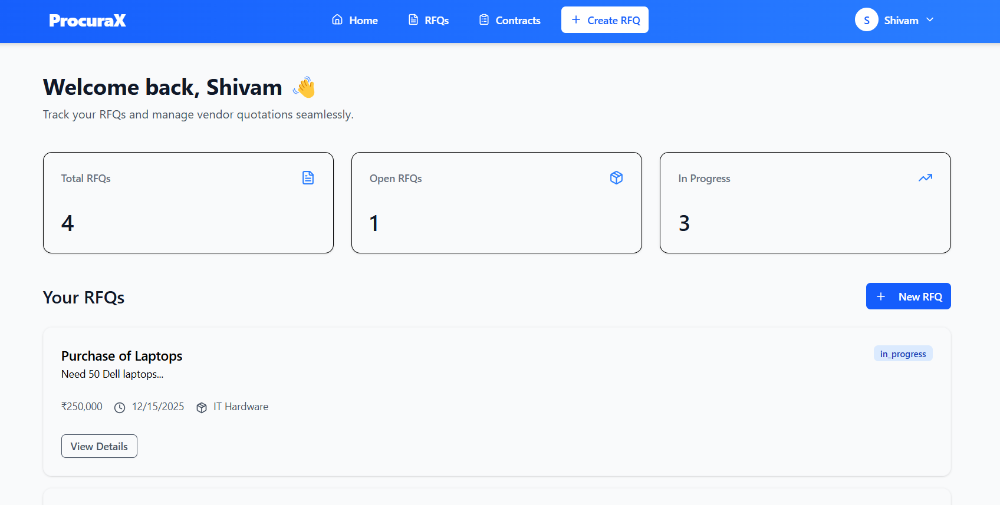
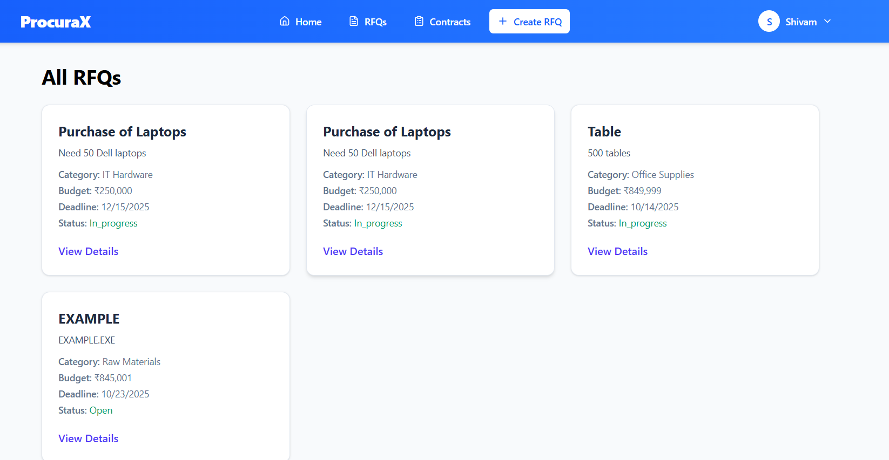
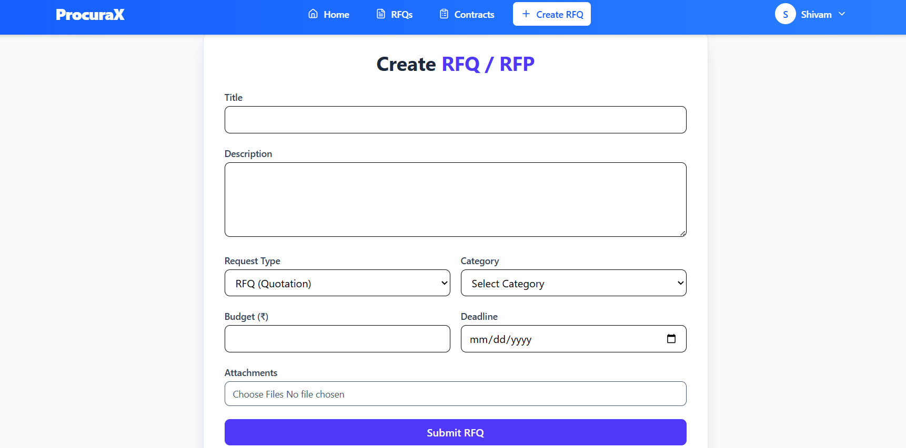
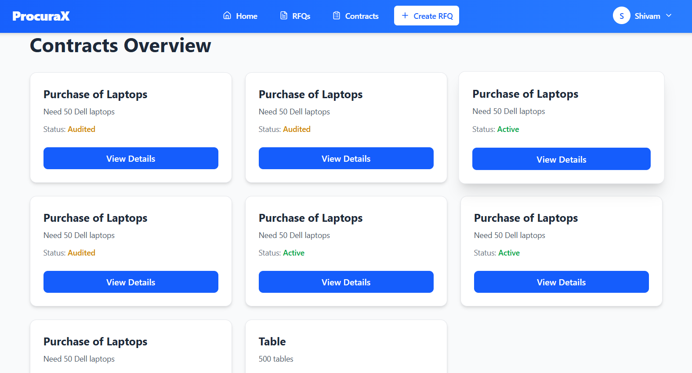
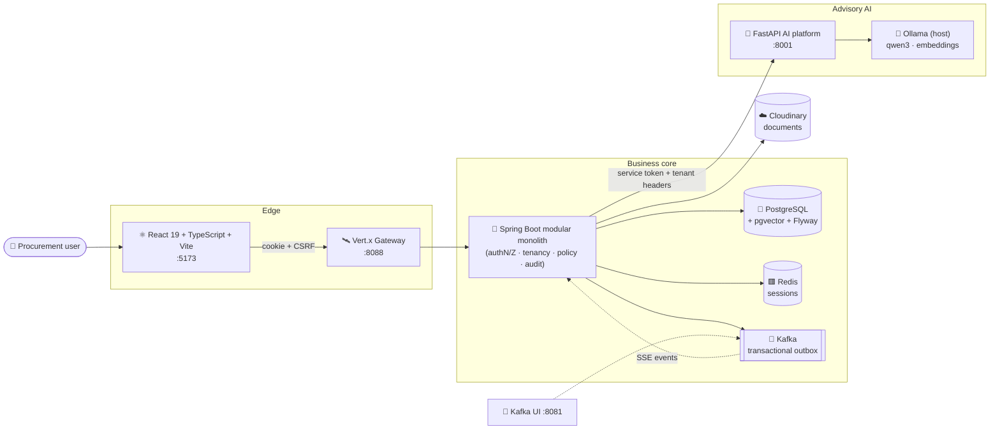

<div align="center">

# 🚀 PROCUREAI

### Agent-assisted procurement & commerce platform

*From RFQ to contract, purchase order, payment and reconciliation — tenant-aware, auditable, and AI-assisted with a human always in the loop.*

<p>
  
  
  
  
</p>
<p>
  
  
  
  
  
  
  
  
  
</p>

[Problem](#-problem-statement) ·
[Solution](#-solution) ·
[Screenshots](#-screenshots) ·
[Architecture](#-architecture) ·
[Quick start](#-quick-start) ·
[Configuration](#-configuration) ·
[Docs](#-documentation)

</div>

---

## 🎯 Problem statement

Procurement lives in a patchwork of **spreadsheets, email threads and loose documents**. As a result:

- 📨 Supplier quotes arrive in different formats and are hard to compare **consistently**.
- 🔐 Permissions are informal — it's unclear **who may approve, sign or pay**.
- 📄 Contracts are long and risky; clause review is slow and **hard to evidence**.
- 🧾 Purchase → shipment → invoice → payment trails are scattered, making **audits painful**.
- 🤖 Naive AI tools can hallucinate or act without oversight — unacceptable for spend decisions.

## 💡 Solution

**ProcureAI** puts the whole procurement lifecycle into one **multi-tenant, permission-enforced** workspace, and adds AI only as an **advisory layer**.

| | What you get |
|---|---|
| 🧩 **One workflow** | RFQs → quotations → approvals → purchase orders → contracts → payments → fulfillment → reconciliation |
| 📊 **Deterministic vendor scoring** | Transparent, weighted factors (price, delivery, quality, compliance, performance, payment terms) |
| 🛡️ **Server-enforced RBAC & tenancy** | Google OIDC sessions, organization scoping, maker-checker approvals, full audit trail |
| 🧠 **Cited contract intelligence** | PDF/DOCX extraction, clause evidence with offsets, pgvector semantic search, local-LLM summaries |
| 🙋 **Human in the loop** | AI never approves, selects vendors, or writes to the database — Spring validates everything |
| ⚡ **Live updates** | Transactional outbox → Kafka → authenticated, org-scoped SSE |

> [!NOTE]
> Payments are **sandbox-only**. AI output is decision support — **not legal, financial or purchasing advice**.
> This project is under active development; see the [migration plan](docs/MIGRATION_PLAN.md) for status.

## 🖼️ Screenshots

<table>
  <tr>
    <td align="center"><b>Sign in</b><br></td>
    <td align="center"><b>Dashboard</b><br></td>
  </tr>
  <tr>
    <td align="center"><b>RFQ list</b><br></td>
    <td align="center"><b>Create RFQ</b><br></td>
  </tr>
  <tr>
    <td align="center" colspan="2"><b>Contracts</b><br></td>
  </tr>
</table>

## ✨ Features

<details open>
<summary><b>🏢 Core procurement</b></summary>

- RFQ drafts with multi-line items, publishing and closing
- Vendor quotation submission, review, accept/reject (server-computed totals)
- Vendor directory, membership assignment, compliance-document verification
- Approvals and immutable purchase orders with full provenance

</details>

<details open>
<summary><b>📑 Contracts & AI</b></summary>

- Drafts from accepted quotations; authenticated PDF/DOCX upload; 5-minute signed download links
- Attributed human review findings and maker-checker approve/reject decisions
- AI evidence retrieval for termination, liability, payment, confidentiality and governing law
- Local embeddings (`qwen3-embedding:0.6b`) stored in **pgvector** (HNSW cosine) for semantic search
- Cited summaries via local `qwen3:8b` — excerpts treated as untrusted input

</details>

<details>
<summary><b>💳 Payments & fulfillment (sandbox)</b></summary>

- Payment mandates, authorization, capture and refund with idempotency keys
- Shipment & invoice metadata, delivery status, immutable reconciliation findings

</details>

<details>
<summary><b>🔒 Security by design</b></summary>

- Google OIDC server-side sessions (Redis), CSRF protection, no JWT in local storage
- Tenant context derived on the server; the AI and gateway services are never trusted to mutate state
- Gateway rate limiting, header sanitization and correlation IDs

</details>

## 🏗️ Architecture



### Components

| Component | Path | Stack | Role |
|---|---|---|---|
| 🖥️ **Frontend** | `Frontend/` | React 19, TS, Vite, Tailwind 4, TanStack Query, Recharts | Workspace UI; Vite proxies `/api` and OAuth via the gateway |
| 🛰️ **Gateway** | `gateway/vertx-gateway/` | Java 21, Vert.x | Thin edge: proxying, rate limiting, header hygiene. No authN/Z |
| 🍃 **Business API** | `services/procurax-platform/` | Java 21, Spring Boot 3.5, JPA, Flyway | Source of truth: auth, RBAC, procurement state, audit, outbox |
| 🧠 **AI platform** | `ai-platform/fastapi/` | Python 3.12, FastAPI, ONNX Runtime | Advisory planning, vendor explanations, contract intelligence |
| 🗄️ **Data/infra** | `docker-compose.yml` | PostgreSQL (pgvector), Redis, Kafka | Persistence, sessions, events |

## 📋 Requirements

| Requirement | Version | Needed for |
|---|---|---|
| **Git** | any recent | Cloning |
| **Docker Desktop** (Compose v2) | latest | Backend stack (required) |
| **Node.js + npm** | 20+ | Frontend (required) |
| Java + Maven | 21 / 3.9+ | Optional: running backend outside Docker |
| Python | 3.12 | Optional: running AI service / tests natively |
| **Ollama** | latest | Optional: contract summaries & embeddings |
| Google OAuth client | — | Optional: sign-in |
| Cloudinary account | — | Optional: document uploads |

> The Java and Python services are built **inside Docker**, so you don't need them installed for the standard setup.

## ⚡ Quick start

```powershell
# 1. Clone
git clone https://github.com/shivammiyyy/ProcuraX.git
Set-Location ProcuraX

# 2. Configure (defaults work for local infra)
Copy-Item .env.example .env

# 3. Start PostgreSQL, Redis, Kafka, Spring, gateway and AI service
docker compose up -d --build
docker compose ps

# 4. Start the frontend (new terminal)
Set-Location Frontend
Copy-Item .env.example .env.local
npm ci
npm run dev
```

Open **<http://localhost:5173>** 🎉

### Enable sign-in (Google OIDC)

Add to `.env`, then run `docker compose up -d` again:

```dotenv
SPRING_PROFILES_ACTIVE=oauth
GOOGLE_CLIENT_ID=your-google-oauth-client-id
GOOGLE_CLIENT_SECRET=your-google-oauth-client-secret
```

Register `http://localhost:5173/login/oauth2/code/google` as an authorized redirect URI in Google Cloud.
Without this profile, business APIs stay protected (401) and login is not registered.

### Enable AI features

```powershell
# Shared backend ↔ AI token — random, at least 32 characters (put it in .env)
#   PROCURAX_AI_SERVICE_TOKEN=<random-32+-char-string>

ollama pull qwen3:8b
ollama pull qwen3-embedding:0.6b
```

Compose reaches host Ollama at `http://host.docker.internal:11434`. Without Ollama the core app still works; only model-backed contract features are unavailable.

### Enable document uploads

Set `CLOUDINARY_CLOUD_NAME`, `CLOUDINARY_API_KEY`, `CLOUDINARY_API_SECRET` in `.env`. Without them, uploads return `503 DOCUMENT_STORAGE_UNAVAILABLE`.

## 🌐 Local endpoints

| Service | URL |
|---|---|
| 🖥️ Frontend | <http://localhost:5173> |
| 🛰️ Gateway (API entry point) | <http://localhost:8088> · health: `/health` |
| 🔎 Kafka UI | <http://localhost:8081> |
| 🧠 AI readiness | <http://localhost:8001/health/ready> (loopback only) |
| 🍃 Spring API | internal to Compose — reach it through the gateway |

## ⚙️ Configuration

<details>
<summary><b>Environment variables (root <code>.env</code>)</b></summary>

| Variable | Purpose | Default |
|---|---|---|
| `DATABASE_PASSWORD` | Local PostgreSQL password | `procurax-local` |
| `SPRING_PROFILES_ACTIVE` | `oauth` enables Google login | — |
| `GOOGLE_CLIENT_ID` / `GOOGLE_CLIENT_SECRET` | OAuth credentials | — |
| `PROCURAX_AI_SERVICE_TOKEN` | Backend ↔ AI bearer token (≥ 32 chars) | — |
| `CLOUDINARY_*` | Document storage credentials | — |
| `OLLAMA_BASE_URL` | Ollama origin | `http://host.docker.internal:11434` |
| `OLLAMA_CHAT_MODEL` | Summary model | `qwen3:8b` |
| `OLLAMA_EMBEDDING_MODEL` | Embedding model (1024-dim) | `qwen3-embedding:0.6b` |
| `GATEWAY_PORT`, `AI_PLATFORM_PORT`, `POSTGRES_PORT`, `REDIS_PORT`, `KAFKA_PORT`, `KAFKA_UI_PORT` | Host port overrides | 8088 / 8001 / 5432 / 6379 / 9092 / 8081 |
| `GATEWAY_RATE_LIMIT_REQUESTS`, `GATEWAY_RATE_LIMIT_WINDOW_MS` | Gateway rate limit | 120 / 60000 |

Frontend (`Frontend/.env.local`): `VITE_DEV_API_PROXY` (default `http://localhost:8088`) and `VITE_API_URL` (leave empty locally).

</details>

## 🧪 Development & tests

```powershell
# Frontend
Set-Location Frontend
npm run typecheck; npm run lint; npm run build

# AI service
Set-Location ..\ai-platform\fastapi
python -m venv .venv; .\.venv\Scripts\Activate.ps1
pip install -r requirements-dev.txt
python -m pytest

# Spring + gateway (Java 21, Maven; Spring tests need Docker for Testcontainers)
Set-Location ..\..\services\procurax-platform; mvn test
Set-Location ..\..\gateway\vertx-gateway; mvn test
```

Stop everything (keeps the database volume):

```powershell
docker compose down
```

Add `-v` only if you want to wipe local data.

## 🗂️ Project structure

```text
ProcuraX
├── Frontend/                    # React + Vite workspace
├── gateway/vertx-gateway/       # Vert.x HTTP edge
├── services/procurax-platform/  # Spring Boot business API + Flyway migrations
├── ai-platform/fastapi/         # FastAPI advisory AI service + ONNX model
├── docs/                        # Architecture, security & feature docs
├── img/                         # Screenshots
└── docker-compose.yml           # Local infrastructure
```

## 📚 Documentation

| Topic | Link |
|---|---|
| Local development | [docs/LOCAL_DEVELOPMENT.md](docs/LOCAL_DEVELOPMENT.md) |
| AI platform | [docs/AI_PLATFORM.md](docs/AI_PLATFORM.md) |
| Procurement APIs | [docs/PROCUREMENT.md](docs/PROCUREMENT.md) |
| Frontend | [docs/FRONTEND.md](docs/FRONTEND.md) |
| Gateway | [docs/GATEWAY.md](docs/GATEWAY.md) |
| Security | [docs/SECURITY.md](docs/SECURITY.md) |
| Outbox & events | [docs/OUTBOX.md](docs/OUTBOX.md) |
| Migration plan | [docs/MIGRATION_PLAN.md](docs/MIGRATION_PLAN.md) |

## 🤝 Contributing

Issues and pull requests are welcome. Please run the relevant tests above before opening a PR and never commit credentials or tokens.

## ⚠️ Disclaimer

An independent project. It does not use or represent any company's proprietary APIs, credentials, internal systems, branding or confidential data.

---

<div align="center">

Built by **[Shivam Jha](https://github.com/shivammiyyy)** · ⭐ Star the repo if you find it useful

</div>
